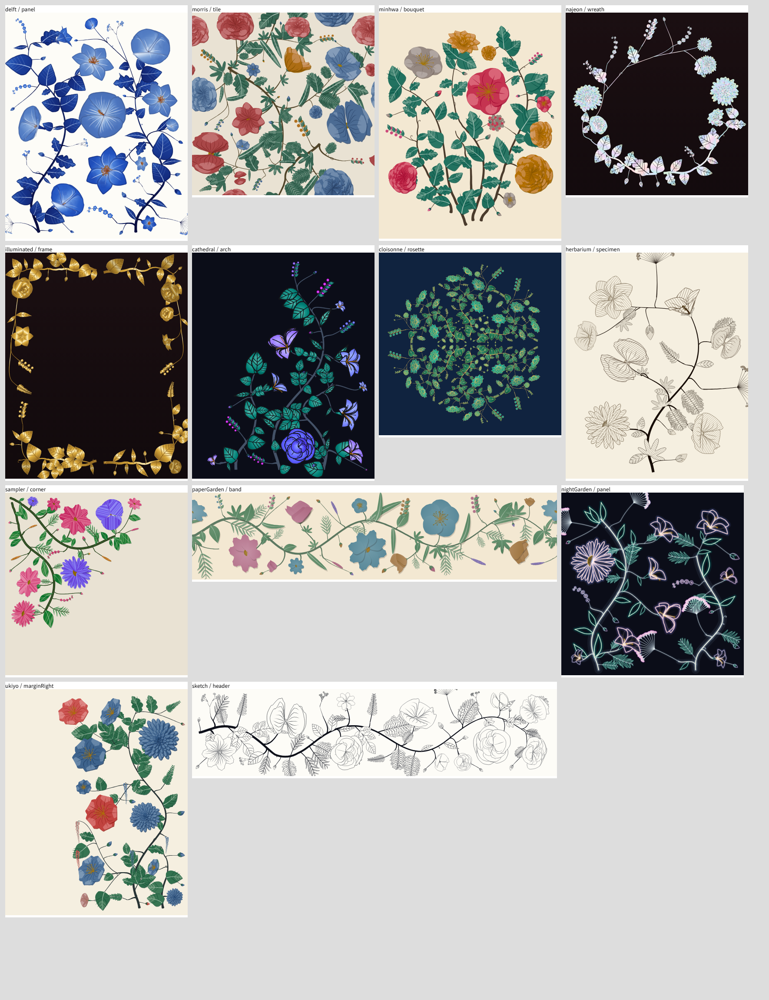

# flora

주어진 공간에 맞춰 꽃 문양을 키우는 TypeScript 라이브러리입니다. 런타임 의존성은 없습니다.
Wong, Zongker, Salesin의 *Computer-Generated Floral Ornament* (SIGGRAPH 1998)를 기준으로 삼았습니다.



- **꽃 22종**: 하나의 3D 꽃잎 모델을 매개변수만 바꿔 씁니다. 장미, 모란, 무궁화, 연꽃, 튤립 등이며 정면과 측면 모두 나옵니다. 교배로 새 품종도 만듭니다.
- **재질 13종**: 수채화, 구아슈, 펜화, 동판화, 금박, 스테인드글라스, 칠보, 나전칠기, 자수, 페이퍼컷, 리소 인쇄, 청자 상감, 네온.
- **공간 16종**: 패널, 여백, 모서리, 액자, 머리글, 바닥글, 띠, 화환, 로제트, 타일, 아치, 꽃다발, 표본, 흩뿌림, 엠블럼. 임의의 영역도 넣을 수 있습니다.
- **스타일 15종**: 위 요소를 묶은 조합입니다. `delft`, `morris`, `minhwa`, `najeon`, `goryeo`, `risograph` 등.
- **앱용 기능**: 같은 시드는 항상 같은 결과를 내고, 본문 영역을 피해서 자라며, SVG와 Canvas로 출력합니다. 웹 워커에서도 돌아가고, 성장 애니메이션을 지원합니다.

## 사용법

```ts
import { flora } from '@labica/flora';

const art = flora({
  width: 800,
  height: 1000,
  seed: 'docs/intro.md',          // 같은 시드는 같은 문양
  style: 'delft',
  composition: 'panel',
  exclude: [{ x: 320, y: 60, width: 440, height: 300 }], // 본문 상자
});

art.toSVG();                      // SVG 문자열
art.toDataURL();                  // CSS background, 
art.draw(canvas.getContext('2d')!);
art.frame(0.5);                   // 절반쯤 자란 장면
```

### 문서

```ts
import '@labica/flora/element';
```

```html
<flora-art seed="docs/intro.md" flora-style="delft" composition="panel" style="height:640px">
  <article data-flora-keep>본문</article>
</flora-art>
```

`data-flora-keep`이 붙은 자식 상자를 재서 그 바깥만 채웁니다. `data-flora-keep="lines"`로 주면 줄마다 글자 폭을 재서, 짧은 줄이 이어진 옆자리까지 꽃이 들어옵니다. 짧은 줄 하나 옆처럼 좁은 틈은 비워 둡니다. 브라우저 밖에서는 `lineBoxes(rects)`로 같은 상자를 만들어 `exclude`에 넘기면 됩니다. 크기가 바뀌면 다시 자랍니다. `animate` 속성을 주면 자라는 과정이 보이며, 사용자가 동작 줄이기를 설정했으면 생략합니다.

### 탐색기

```ts
import { flora, identity } from '@labica/flora';

const icon = flora({
  ...identity('photos/2026/jeju.jpg', 'photos/2026'), // 두 번째 인자는 형제끼리 공유할 가문
  width: 88,
  height: 88,
  composition: 'emblem',
  surface: 'transparent',
});
img.src = icon.toDataURL();
```

### 내 꽃, 내 재질, 내 공간

```ts
import { flora, ellipse, hybrid, subtract } from '@labica/flora';

flora({
  width: 600, height: 600,
  region: subtract(ellipse(300, 300, 290), ellipse(300, 300, 120)),
  flowers: [hybrid('peony', 'lily'), 'mugunghwa'],
  palette: '#7a2e8e',             // 잉크 하나로 팔레트 전체를 만듭니다
  material: 'najeon',
});
```

`Species`와 `Material`은 일반 객체라서 직접 정의해 넘길 수 있습니다. 꽃은 `Whorl` 배열이고, 재질은 `Part`를 받아 그리기 명령을 돌려주는 함수입니다.

## 구조

두 단계로 나뉩니다. 먼저 기하를 키우고, 그다음 재질이 칠합니다. 논문의 핵심 구조이고, 그래서 어떤 꽃이든 어떤 재질로든 칠할 수 있습니다.

| 폴더 | 역할 |
|---|---|
| `src/core` | 시드 난수, 기하, OKLCH 색 |
| `src/botany` | 꽃, 잎, 꽃차례. 결과는 재질과 무관한 `Part` |
| `src/grow` | 영역, 빈 공간 장, 적응형 클립아트 엔진 |
| `src/material` | `Part`를 그리기 명령으로 바꾸는 재질과 바탕 |
| `src/scene` | SVG, Canvas 렌더러 |
| `src/compose.ts`, `src/styles.ts` | 공간 배치, 스타일 조합 |

연구 정리와 설계 근거는 [docs/RESEARCH.md](docs/RESEARCH.md)에 있습니다.

## 성능 가이드

- 비용은 대부분 그리기 명령 수에서 나옵니다. 640×760 기준 SVG는 0.5~1.6MB, gzip으로 0.1~0.4MB입니다. `npm run size`로 스타일별 크기를 볼 수 있습니다.
- `art.toSVG({ tolerance: 0.2 })`처럼 허용 오차를 올리면 더 작아지지만 작은 차이가 보이기 시작합니다. 기본값 0.08px은 6배 확대해도 원본과 구분되지 않는 수준입니다.
- 큰 문양은 SVG보다 `art.draw()`가 낫습니다. 결과를 비트맵으로 캐시해 두세요.
- `detail`을 낮추면 명령 수가 줄어듭니다. 작은 크기에서는 자동으로 낮아집니다.

## 개발

```sh
npm install
npm test            # Node 내장 테스트 러너
npm run typecheck
npm run build       # dist/
npm run demo        # demo/out/index.html 플레이그라운드
```

Node 22.6 이상이 필요합니다.


